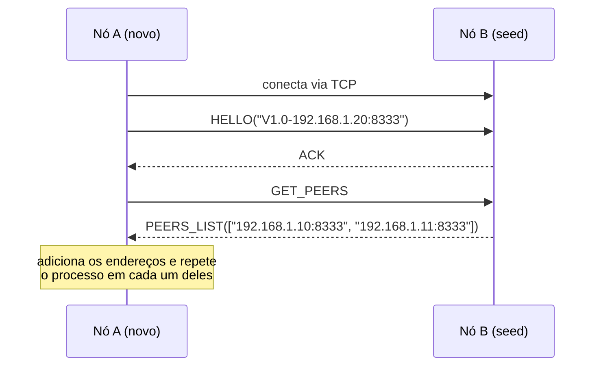
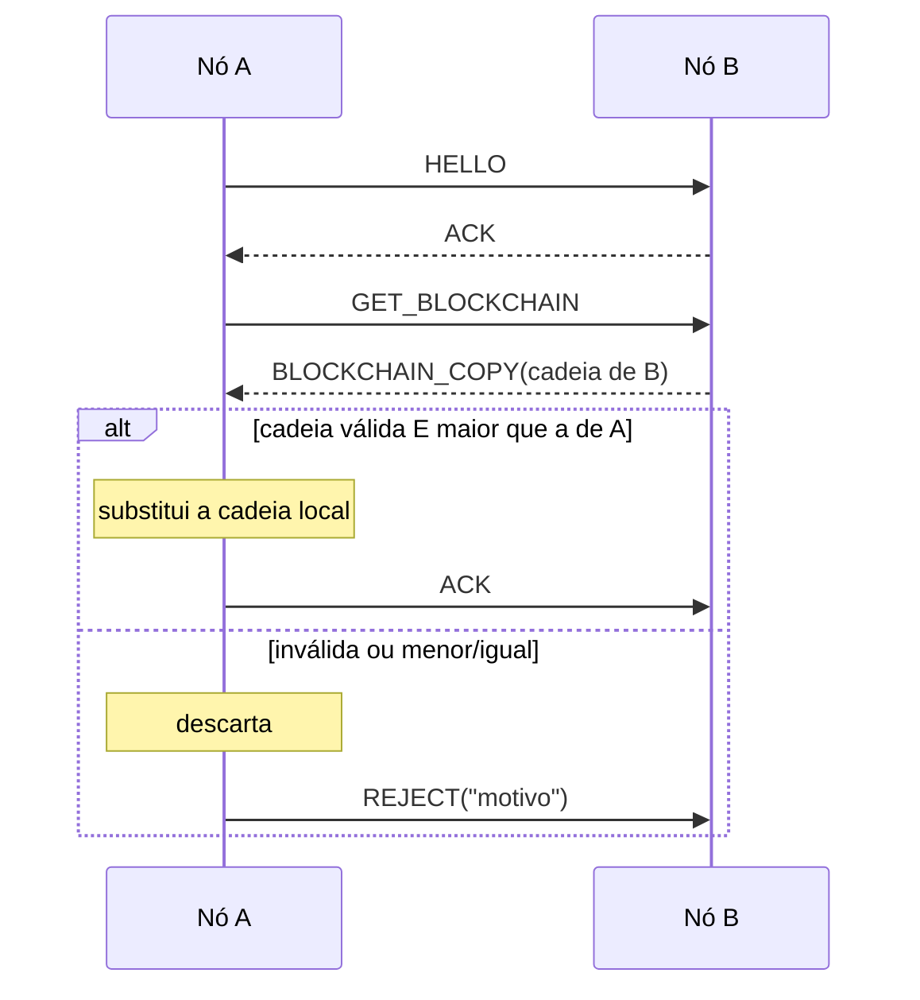
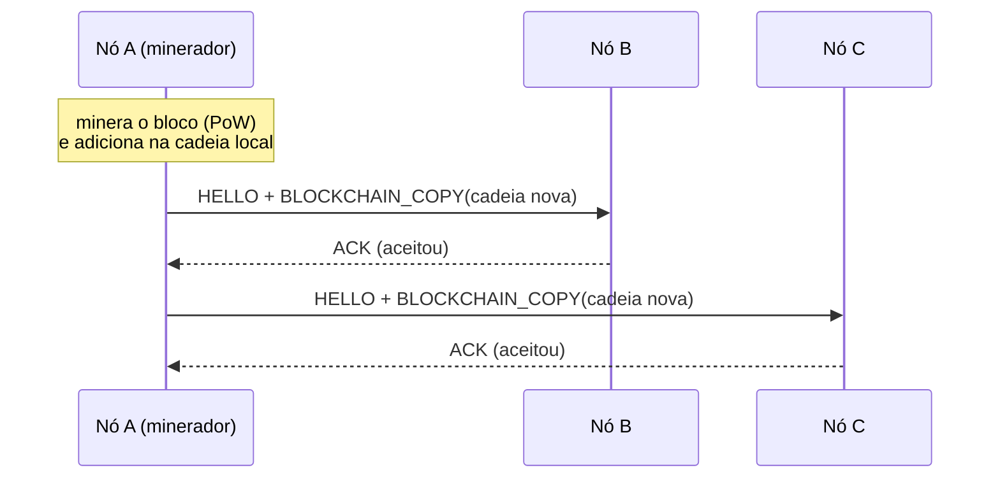

# BCP — Blockchain Copy Protocol

Uma blockchain simplificada, escrita em Java, em que vários computadores (nós) mantêm **a mesma cópia** da cadeia de blocos conversando entre si numa rede **P2P** (*peer-to-peer*).

Este README explica primeiro **os conceitos**, depois **como rodar** e por fim **como o código está organizado**.

---

## Sumário

1. [Conceitos em 5 minutos](#1-conceitos-em-5-minutos)
2. [Como o protocolo funciona](#2-como-o-protocolo-funciona)
3. [Pré-requisitos](#3-pré-requisitos)
4. [Compilando](#4-compilando)
5. [Rodando passo a passo](#5-rodando-passo-a-passo)
6. [Roteiro de demonstração](#6-roteiro-de-demonstração)
7. [Rodando os testes](#7-rodando-os-testes)
8. [Organização do código](#8-organização-do-código)
9. [Rotas do protocolo (para o programador)](#9-rotas-do-protocolo-para-o-programador)
10. [Problemas comuns](#10-problemas-comuns)

---

## 1. Conceitos em 5 minutos

### Bloco
Um **bloco** guarda alguns dados (ex.: `"Ana paga 10 para Bruno"`) e um **hash**, que funciona como uma impressão digital calculada a partir de todo o conteúdo do bloco:

```
hash = SHA-256( índice | timestamp | previousHash | nonce | dados )
```

Se uma única letra dos dados mudar, o hash muda completamente.

### Cadeia (blockchain)
Cada bloco guarda o hash do bloco anterior (`previousHash`). Isso forma uma corrente:

```
┌──────────────┐     ┌──────────────┐     ┌──────────────┐
│ #0 Gênesis   │     │ #1           │     │ #2           │
│ hash: 0199.. │◄────│ prev: 0199.. │◄────│ prev: 0000a1.│
│              │     │ hash: 0000a1.│     │ hash: 00003f.│
└──────────────┘     └──────────────┘     └──────────────┘
```

Adulterar o bloco #1 muda o hash dele, e o `prev` do bloco #2 deixa de bater. Por isso a fraude é detectada.
O primeiro bloco (**gênesis**) é fixo e igual em todos os nós.

### Prova de trabalho (Proof of Work)
Para um bloco ser aceito, o hash dele precisa **começar com 4 zeros** (`0000...`). O único jeito de conseguir isso é testar valores do campo `nonce` (0, 1, 2, ...) até encontrar um que funcione. Isso é **minerar**.
Minerar é caro; conferir é barato, basta recalcular um hash.

### Rede P2P e Servent
Não existe servidor central. Cada nó é **ao mesmo tempo**:
- **Servidor**: escuta conexões de outros nós numa porta TCP (padrão `8333`) e responde a pedidos.
- **Cliente**: conecta em outros nós para pedir a lista de peers e a blockchain, ou para anunciar blocos novos.

Esse nó de duplo papel se chama **Servent** (*Server + Client*).

### Consenso: regra da maior cadeia válida
Quando um nó recebe a cadeia de outro, ele **só troca a sua** se a recebida for:
1. **válida** (hashes corretos, encadeamento correto, prova de trabalho em todos os blocos e mesmo gênesis), **e**
2. **maior** que a local.

Caso contrário, descarta e responde `REJECT`.

---

## 2. Como o protocolo funciona

Toda comunicação é feita por **TCP**. Cada mensagem é um objeto `NetworkMessage` com dois campos:

| Campo | Tipo | Exemplo |
|---|---|---|
| `type` | `MessageType` | `GET_PEERS` |
| `payload` | `Serializable` | `null`, uma `String`, uma lista de peers ou de blocos |

Os objetos viajam pela rede com a serialização nativa do Java (`ObjectOutputStream` / `ObjectInputStream`).

### Tipos de mensagem

| Tipo | Quem envia | Payload | Para quê |
|---|---|---|---|
| `HELLO` | Cliente | `"V1.0-<ip>:<porta>"` | Apresentação (*handshake*): versão do protocolo e ID do nó |
| `ACK` | Ambos | `String` | "Deu certo" |
| `REJECT` | Ambos | `String` com o motivo | "Recusado" (versão errada, cadeia inválida, ...) |
| `GET_PEERS` | Cliente | `null` | "Quais nós você conhece?" |
| `PEERS_LIST` | Servidor | `List<String>` `"IP:Porta"` | Resposta ao `GET_PEERS` |
| `GET_BLOCKCHAIN` | Cliente | `null` | "Me mande sua blockchain" |
| `BLOCKCHAIN_COPY` | Ambos | `ArrayList<Block>` | A cadeia inteira (resposta ou anúncio de bloco novo) |

> Regra: toda conexão começa com `HELLO`. Qualquer outra mensagem antes disso recebe `REJECT`.

### Fluxo A — Entrar na rede e descobrir peers

O nó novo só conhece uma **seed** (um endereço fixo gravado no código ou passado na linha de comando). A partir dela, descobre os demais.



### Fluxo B — Sincronizar a blockchain



### Fluxo C — Minerar e anunciar um bloco novo



Além disso, **a cada 30 segundos** cada nó repete os fluxos A e B sozinho, para incluir nós que entraram depois ou perderam algum anúncio.

---

## 3. Pré-requisitos

- **Java 17 ou superior** (testado com OpenJDK 21). Confira com:
  ```bash
  java -version
  javac -version
  ```
- Se o `javac` não existir, instale o JDK (no Ubuntu/Debian: `sudo apt install openjdk-21-jdk`) ou use o atalho da seção 4.

---

## 4. Compilando

Na pasta do projeto:

```bash
javac -d out *.java
```

Isso gera os arquivos `.class` dentro da pasta `out/`.

> **Sem `javac`?** Se o seu Java só tem o JRE, mas inclui o módulo do compilador, rode:
> ```bash
> java --module jdk.compiler/com.sun.tools.javac.Main -d out *.java
> ```

---

## 5. Rodando passo a passo

O comando geral é:

```bash
java -cp out No [porta] [seed1] [seed2] ...
```

| Argumento | Significado | Padrão |
|---|---|---|
| `porta` | Porta TCP onde este nó escuta | `8333` |
| `seed` | Endereço `IP:Porta` de um nó que já está na rede | `127.0.0.1:8333` (constante `SEED_NODES` em `No.java`) |
| `-Dbcp.host=IP` | (opcional, antes de `-cp`) força o IP com que o nó se identifica | detectado automaticamente |

### Opção 1: tudo em um computador só

Abra **5 terminais** na pasta do projeto e rode um comando em cada:

```bash
java -cp out No 8333   # terminal 1: a seed
java -cp out No 8334   # terminal 2
java -cp out No 8335   # terminal 3
java -cp out No 8336   # terminal 4
java -cp out No 8337   # terminal 5
```

Sem argumentos de seed, todos usam `127.0.0.1:8333`. Em poucos segundos cada nó conhece os outros 4 (veja com a opção `3` do menu).

### Opção 2: vários computadores na rede local (laboratório)

1. **Escolha um computador para ser a seed** e descubra o IP dele:
   - Linux: `ip a` (procure algo como `192.168.x.x`)
   - Windows: `ipconfig`
2. **Na seed:**
   ```bash
   java -cp out No 8333
   ```
3. **Em cada um dos outros computadores**, apontando para o IP da seed:
   ```bash
   java -cp out No 8333 192.168.1.10:8333
   ```
4. Se não conectar, **libere a porta no firewall** da seed (ex.: `sudo ufw allow 8333/tcp`) e confirme que todos estão na mesma rede.

> Dica: em vez de passar a seed na linha de comando, você pode trocar `SEED_NODES` em `No.java` pelo IP da seed e recompilar.

### O menu de cada nó

```
==== No 192.168.1.10:8333 | blocos: 1 | peers: 4 ====
1) Minerar novo bloco e anunciar (Fluxo C)
2) Mostrar blockchain
3) Mostrar peers conhecidos
4) Descobrir peers (Fluxo A)
5) Sincronizar blockchain (Fluxo B)
6) Adicionar peer manualmente
0) Sair
```

---

## 6. Roteiro de demonstração

Um roteiro sugerido para a apresentação, com 5 nós:

| Passo | Onde | Ação | O que observar |
|---|---|---|---|
| 1 | Todos | Inicie a seed e depois os outros nós | Logs `Novo peer: ...` aparecendo em todos |
| 2 | Qualquer nó | Opção `3` | Lista com os outros 4 peers (descoberta transitiva) |
| 3 | Nó 2 | Opção `1`, digite `Ana paga Bruno` | `Bloco #1 minerado em ... ms` e `ACK (Cadeia aceita)` de cada peer |
| 4 | Nó 4 | Opção `2` | O bloco #1 do nó 2 já está lá |
| 5 | Nó 5 | Opção `0` (desligar) | Os outros continuam funcionando |
| 6 | Nó 3 | Opção `1`, digite `Carla paga Davi` | Bloco #2 propagado para os nós ativos |
| 7 | Nó 5 | Ligue de novo | Ao entrar, ele sincroniza e recebe os blocos #1 e #2 (Fluxo B) |
| 8 | Todos | Opção `2` | Todos com a **mesma** cadeia e `valida=true` |

---

## 7. Rodando os testes

Os testes usam **JUnit 5**. O jar já vem na pasta `lib/`, então funciona sem internet e sem Maven:

```bash
javac -cp lib/junit-platform-console-standalone-1.11.4.jar -d out *.java test/*.java
java -jar lib/junit-platform-console-standalone-1.11.4.jar execute -cp out --scan-classpath
```

| Classe de teste | O que verifica |
|---|---|
| `BlockTest` | O hash é determinístico, muda com os dados, e a mineração gera os zeros |
| `BlockchainTest` | `isChainValid` detecta adulteração, encadeamento quebrado, falta de PoW, etc.; regra da maior cadeia |
| `NetworkMessageTest` | Uma mensagem com blocos sobrevive à serialização |
| `NoTest` | Payloads inválidos são recusados; o nó não adiciona a si mesmo como peer |
| `ServidorRotasTest` | Cada rota do servidor, com sockets reais em portas livres |
| `FluxosTest` | Fluxos A e B completos entre vários nós |

Os testes levam cerca de 20 s, por causa da mineração.
Em uma IDE (IntelliJ, VS Code, Eclipse), adicione o jar de `lib/` ao classpath e rode a pasta `test/`.

---

## 8. Organização do código

```
.
├── No.java              ← ponto de entrada (main): menu e fluxos A, B e C
├── Servidor.java        ← papel de servidor: recebe mensagens e despacha para as rotas
├── Cliente.java         ← papel de cliente: um método para cada requisição
├── NetworkMessage.java  ← o "envelope" de toda mensagem (type + payload)
├── MessageType.java     ← os tipos de mensagem
├── Block.java           ← um bloco: hash SHA-256 e mineração
├── Blockchain.java      ← a cadeia: validação e regra da maior cadeia
├── test/                ← testes JUnit 5
└── lib/                 ← jar do JUnit
```

Como as classes se relacionam:

```
           ┌────────────────────── No ──────────────────────┐
           │  menu · peers · descobrirPeers · sincronizar   │
           │                     minerarEAnunciar           │
           └───────┬───────────────────┬────────────────┬───┘
                   │ thread            │ usa            │ tem
                   ▼                   ▼                ▼
              Servidor              Cliente         Blockchain
          (conexões que         (conexões que      (List<Block>)
             chegam)                saem)
                   └──── trocam NetworkMessage ────┘
```

---

## 9. Rotas do protocolo (para o programador)

### Servidor: o que ele faz ao receber cada mensagem

Tudo está registrado em um único lugar, `Servidor.registrarRotas()`:

```java
rotas.put(MessageType.HELLO,           this::onHello);          // -> ACK | REJECT
rotas.put(MessageType.GET_PEERS,       this::onGetPeers);       // -> PEERS_LIST
rotas.put(MessageType.GET_BLOCKCHAIN,  this::onGetBlockchain);  // -> BLOCKCHAIN_COPY
rotas.put(MessageType.BLOCKCHAIN_COPY, this::onBlockchainCopy); // -> ACK | REJECT
rotas.put(MessageType.ACK,             this::onAck);            // sem resposta
rotas.put(MessageType.REJECT,          this::onReject);         // sem resposta
```

### Cliente: um método por requisição

| Método | Envia | Espera |
|---|---|---|
| `new Cliente(endereco, id)` | `HELLO` | `ACK` (senão lança `IOException`) |
| `requisitarPeers()` | `GET_PEERS` | `PEERS_LIST` |
| `requisitarBlockchain()` | `GET_BLOCKCHAIN` | `BLOCKCHAIN_COPY` |
| `confirmarCadeia()` / `rejeitarCadeia(motivo)` | `ACK` / `REJECT` | — |
| `anunciarBlockchain(cadeia)` | `BLOCKCHAIN_COPY` | `ACK` ou `REJECT` |

Exemplo de uso:

```java
try (Cliente c = new Cliente("192.168.1.10:8333", meuId)) {
    List<String> peers = c.requisitarPeers();
}
```

### Como adicionar uma mensagem nova (exemplo: `PING`)

1. Adicione `PING` em `MessageType.java`.
2. Em `Servidor.java`, escreva o handler:
   ```java
   private NetworkMessage onPing(Sessao sessao, NetworkMessage msg) {
       return new NetworkMessage(MessageType.ACK, "pong");
   }
   ```
3. Registre-o em `registrarRotas()`: `rotas.put(MessageType.PING, this::onPing);`
4. Em `Cliente.java`, crie o método que envia: `enviar(MessageType.PING, null); return receber();`
5. Escreva um teste em `test/ServidorRotasTest.java`.

---

## 10. Problemas comuns

| Sintoma | Causa provável | Solução |
|---|---|---|
| `Address already in use` | Já existe um nó (ou outro programa) nessa porta | Use outra porta ou feche o processo antigo |
| `Connection refused` ao iniciar | A seed ainda não está rodando | Normal: o nó tenta de novo a cada 30 s. Ou inicie a seed primeiro |
| `Connection timed out` entre computadores | Firewall ou rede diferente | Libere a porta (`sudo ufw allow 8333/tcp`) e confira os IPs |
| Os nós não se veem, mas não há erro | Seed apontando para `127.0.0.1` em outro computador | Passe o IP real da seed: `java -cp out No 8333 192.168.1.10:8333` |
| `javac: command not found` | Só o JRE está instalado | Instale o JDK ou use o comando da seção 4 |
| Bloco "descartado" ao minerar | Outro nó mandou uma cadeia maior durante a mineração | Minere de novo: o bloco será criado sobre a cadeia nova |
